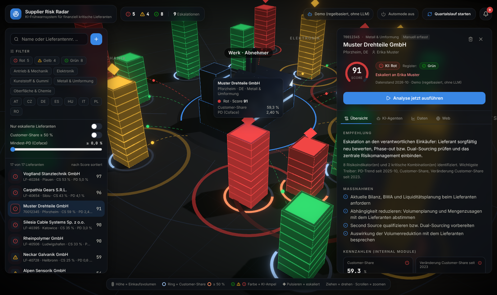
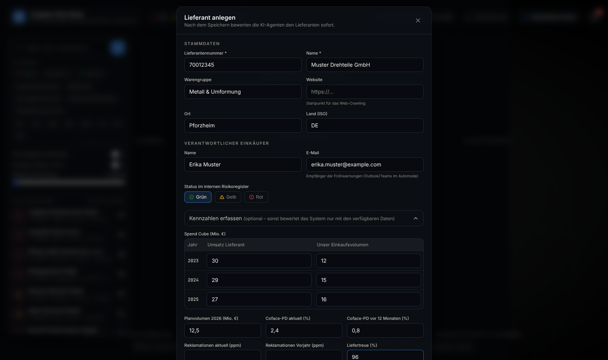
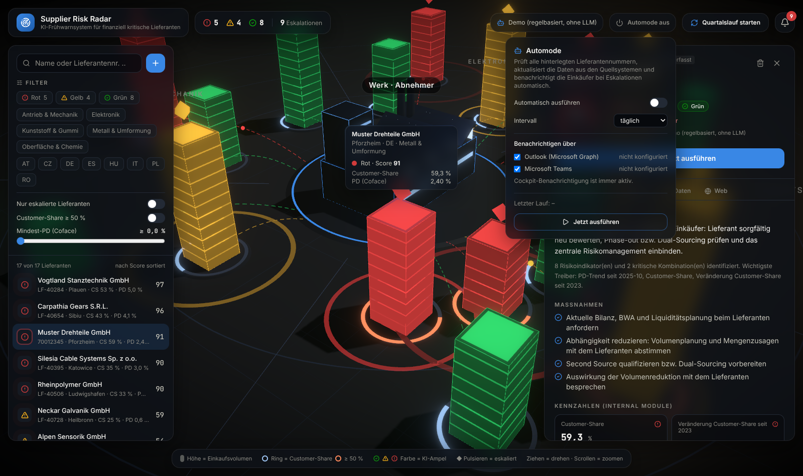

# Supplier Risk Radar

Ein Agentensystem bewertet alle hinterlegten Lieferanten. Es verknüpft interne Kennzahlen (Customer-Share, Umsatzentwicklung, Planvolumen, Coface-PD, Qualität) mit externen Web-Informationen. Daraus entstehen eine nachvollziehbare Argumentationskette und eine Ampel. Bei einer Eskalation wird der verantwortliche Einkäufer benachrichtigt, im Automode auch per Outlook und Teams.

Das 3D-Cockpit zeigt das Werk des Abnehmers in der Mitte und die Lieferanten als Gebäude ringsum, gruppiert nach Warengruppe. Du kannst nach Name oder Lieferantennummer suchen, filtern und neue Lieferanten direkt anlegen.



| Lieferant anlegen | Automode |
|---|---|
|  |  |

## Vom Paper zur Software

| Paper (Abbildung 2–4) | Umsetzung |
|---|---|
| **Internal Module**: Stammdaten, Spend Cube, Demand Planning, Quality Management, Risk Management | `backend/app/modules/internal_module.py`: berechnet bis zu 11 KPIs, jeweils mit Formel, Schwelle und Quelle. Fehlende Quellen werden ausgewiesen statt geraten. |
| **External Module**: Webcrawler + AI Agent External Data | `backend/app/modules/external_module.py`: Crawling der Lieferanten-Website (beachtet robots.txt) und News-Suche; Klassifikation nach Kategorie, Signal und Schwere |
| **Decision Module**: Mapping Indicators → Cross-Referencing → Argumentation Generation → AI Decision Making → Escalation? | `backend/app/modules/decision_module.py` + `backend/app/pipeline.py`: feste Task-Liste in genau dieser Reihenfolge, live im Cockpit verfolgbar |
| Internal / External / Result Data Storage | SQLite (`backend/app/db.py`) |
| Datenintegration aus internen Systemen über APIs | `backend/app/connectors/`: SAP S/4HANA, generisches ERP über REST, manuelle Erfassung |
| Benachrichtigung des Einkäufers | `backend/app/notifiers/`: Cockpit, Outlook (Microsoft Graph), Microsoft Teams |
| Regelmäßige, automatische Bewertung (z. B. quartalsweise) | `backend/app/automode.py` |
| Offline-LLM für interne Daten | `LLM_PROVIDER=ollama` |

**Designentscheidung: Code rechnet, KI argumentiert.** KPIs, Prognose und Score werden deterministisch im Code berechnet. Die LLM-Agenten übernehmen drei Aufgaben: Web-Dokumente klassifizieren, die Argumentationskette formulieren und die Ampel entscheiden. Dabei dürfen sie höchstens eine Stufe vom regelbasierten Score abweichen und müssen das begründen. Ohne LLM (`LLM_PROVIDER=demo`) laufen alle Agenten regelbasiert.

## Lieferanten erfassen und suchen

- **Im Cockpit:** Über **＋** neben dem Suchfeld legst du einen Lieferanten an.
  - Pflicht sind nur Lieferantennummer und Name.
  - Optional erfasst du Kennzahlen: Spend Cube der letzten drei Jahre, Planvolumen, Coface-PD aktuell und vor 12 Monaten, Reklamationen und Liefertreue.
  - Direkt nach dem Speichern bewerten die Agenten den Lieferanten. Fehlen Datenquellen, weist die Bewertung das sichtbar aus.
- **Suche:** Das Suchfeld filtert nach Name und Lieferantennummer, außerdem nach Ort, Warengruppe und Einkäufer. Weitere Filter: Ampel, Warengruppe, Land, Eskalationen, Customer-Share ≥ 50 % und Mindest-PD.
- **Über die API:** `POST /api/suppliers` (Stammdaten + optionale `figures`) oder `POST /api/suppliers/import` (aus einem Quellsystem, siehe unten).

## Schnittstellen (Backend)

Die Schnittstellen zu SAP, weiteren Systemen, Outlook und Teams sind im Backend vollständig vorbereitet und per Umgebungsvariable aktivierbar. Ohne Konfiguration melden sie „nicht konfiguriert“, der Rest der App läuft normal weiter.

⚠️ Getestet sind sie bisher nur gegen simulierte Antworten, nicht gegen echte SAP- oder Microsoft-365-Systeme.

### Quellsysteme: Lieferantennummern suchen

Jedes System implementiert `SourceConnector` (`backend/app/connectors/base.py`):

| Methode | Zweck |
|---|---|
| `search(query)` | Lieferanten nach Nummer oder Name suchen |
| `get_master(number)` | Stammdaten zu einer Lieferantennummer |
| `get_internal_data(number)` | Kennzahlen für das Internal Module (Format siehe unten) |

| Connector | ID | Konfiguration | Stand |
|---|---|---|---|
| Cockpit (manuell erfasst) | `local` | – | aktiv |
| SAP S/4HANA | `sap` | `SAP_BASE_URL`, `SAP_CLIENT`, `SAP_USER`, `SAP_PASSWORD` | Suche und Stammdaten über OData `API_BUSINESS_PARTNER/A_Supplier`. Kennzahlen sind unternehmensspezifisch (Einkaufsinfosätze, Bestellhistorie, IBP/BW, QM-Meldungen); die Zuordnung ergänzt man in `get_internal_data`. |
| Beliebiges System über REST | `erp` | `ERP_NAME`, `ERP_BASE_URL`, `ERP_TOKEN` | erwartet `GET /suppliers?q=`, `GET /suppliers/{nr}`, `GET /suppliers/{nr}/risk-data` |

Ein neues System anbinden heißt: eine Klasse von `SourceConnector` ableiten und in `connectors/__init__.py` registrieren.

API:

```http
GET  /api/sources                                    # registrierte Systeme + Status
GET  /api/sources/search?q=7001&source=sap&source=erp # Suche, auf Quellsysteme filterbar
POST /api/suppliers/import  {"source": "sap", "number": "100200", "buyer_email": "…"}
```

### Benachrichtigungen: Outlook & Teams

| Kanal | ID | Konfiguration |
|---|---|---|
| Cockpit (Glocke) | `inapp` | – |
| Outlook über Microsoft Graph `sendMail` | `outlook` | App-Registrierung in Entra ID mit Application-Permission `Mail.Send` (Admin-Consent; per Application Access Policy auf das Absender-Postfach beschränken) → `MS_TENANT_ID`, `MS_CLIENT_ID`, `MS_CLIENT_SECRET`, `OUTLOOK_SENDER` |
| Microsoft Teams (Adaptive Card) | `teams` | Im Kanal: *Workflows → „Post to a channel when a webhook request is received“* → URL als `TEAMS_WEBHOOK_URL` |

Die Mail geht an die E-Mail-Adresse des Einkäufers aus den Stammdaten. Mail und Teams-Karte enthalten Score, Empfehlung, Maßnahmen und einen Direktlink (`APP_BASE_URL/?supplier=…`). Jeder Zustellversuch wird mit Status protokolliert (`GET /api/notifications`).

### Automode

Der Automode prüft in einem einstellbaren Intervall **alle hinterlegten Lieferantennummern**. Für jeden Lieferanten macht er drei Dinge:

1. aktualisiert Stammdaten und Kennzahlen aus dem jeweiligen Quellsystem,
2. führt die komplette Agenten-Pipeline aus,
3. schickt bei einer Eskalation automatisch eine Mail und/oder Teams-Nachricht an den verantwortlichen Einkäufer.

Einschalten lässt er sich im Cockpit (Schalter „Automode“), über die API (`PUT /api/automode {"enabled": true, "interval_minutes": 1440, "channels": ["outlook","teams"]}`, sofort starten mit `POST /api/automode/run`) oder mit `AUTOMODE_ENABLED=true` als Startwert.

## Schnellstart

### Mit Docker

```bash
cp .env.example .env          # LLM, SAP, Microsoft 365 … nach Bedarf eintragen
docker compose up --build
# → http://localhost:8000
```

### Entwicklung

```bash
# Backend
cd backend
python -m venv .venv && source .venv/bin/activate
pip install -r requirements.txt
uvicorn app.main:app --reload --port 8000

# Frontend (zweites Terminal)
cd frontend
npm install
npm run dev
# → http://localhost:5173
```

Tests: `cd backend && pytest`

Alle Einstellungen stehen kommentiert in [`.env.example`](.env.example). Mit `SEED_DEMO_DATA=false` startet das System ohne die fiktiven Demo-Lieferanten.

## Datenformat Internal Module

So liefern Quellsysteme die Kennzahlen (`get_internal_data` bzw. `GET /suppliers/{nr}/risk-data`). Alle Blöcke sind optional:

```jsonc
{
  "as_of": "2025-12",
  "revenue":  { "2023": 40.1, "2024": 41.0, "2025": 39.2 },  // Lieferantenumsatz, Mio. €
  "purchase": { "2023": 12.3, "2024": 13.0, "2025": 14.1 },  // unser Einkaufsvolumen (Spend Cube)
  "plan_snapshots": [                                          // Planstände aus der Bedarfsplanung
    { "date": "2025-Q3", "volumes": { "2026": 13.5, "2027": 13.9 } }
  ],
  "pd_history": [ { "date": "2025-05-01", "pd": 0.8 } ],      // Coface-Ratingstände
  "quality": { "2025": { "ppm": 45, "otd": 0.97 } }           // Reklamationen, Liefertreue
}
```

Die Schwellenwerte stehen zentral in `THRESHOLDS` (`internal_module.py`), die Gewichte in `GROUP_WEIGHTS` (`decision_module.py`).

## API-Übersicht

| Methode | Pfad | Zweck |
|---|---|---|
| GET | `/api/suppliers?q=` | Lieferanten mit aktueller Bewertung, Suche nach Name/Nummer |
| POST | `/api/suppliers` | Lieferant anlegen (und sofort bewerten) |
| PUT / DELETE | `/api/suppliers/{id}` | Lieferant ändern / löschen |
| GET | `/api/suppliers/{id}` | Bericht und Verlauf |
| POST | `/api/suppliers/{id}/analyze` | Pipeline ausführen (Server-Sent Events) |
| POST | `/api/cycle` | Alle Lieferanten bewerten (Server-Sent Events) |
| GET | `/api/sources`, `/api/sources/search` | Quellsysteme und Suche |
| POST | `/api/suppliers/import` | Lieferant aus Quellsystem übernehmen |
| GET | `/api/channels`, `/api/notifications` | Kanäle und Zustellprotokoll |
| GET / PUT | `/api/automode` | Automode-Status und -Einstellungen |
| POST | `/api/automode/run` | Automode-Lauf sofort starten |

## Grenzen

- Die im Paper gezeigte Genauigkeit stammt aus einem einzigen Fall. Das belegt die Machbarkeit, aber keine allgemein gültige Trefferquote.
- Die Anbindung an SAP, weitere Systeme und Microsoft 365 muss gegen die jeweilige Unternehmensumgebung getestet werden.
- Für SAP fehlt noch die unternehmensspezifische Zuordnung der Transaktionsdaten.
