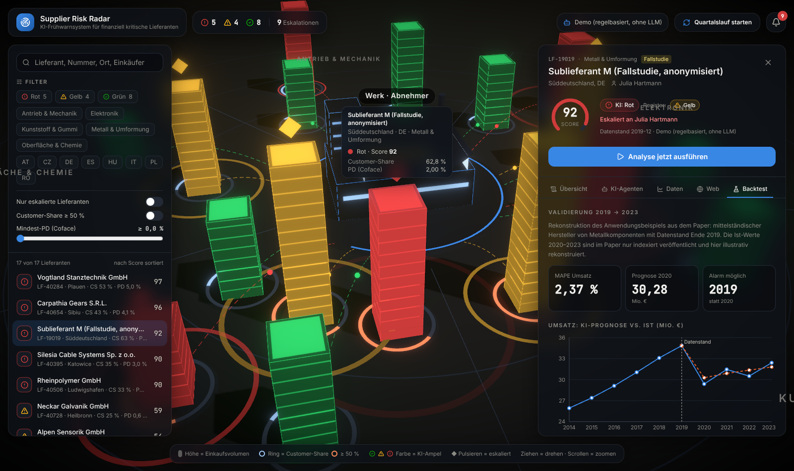

# Supplier Risk Radar

**KI-Frühwarnsystem für finanziell kritische Lieferanten** – eine lauffähige Umsetzung des Referenzmodells aus

> Claussen, C.; Haas, F.; Schätter, F.: *Early Detection of Financially Critical Suppliers with Artificial Intelligence: A Design-Oriented Case Study in Automotive Purchasing.* Hochschule Pforzheim.

Ein Agentensystem bewertet jedes Quartal alle Lieferanten. Es verknüpft interne Kennzahlen (Customer-Share, Umsatzentwicklung, Planvolumen, Coface-PD, Qualität) mit externen Web-Informationen. Daraus entsteht eine nachvollziehbare Argumentationskette, eine Ampel und gegebenenfalls eine Eskalation an den verantwortlichen Einkäufer. Das 3D-Cockpit zeigt das Werk des Abnehmers in der Mitte und die Lieferanten als Gebäude ringsum, gruppiert nach Warengruppe. Suche und Filter helfen, die kritischen Lieferanten schnell zu finden.


| KI-Agenten & Argumentationskette | Backtest der Fallstudie (2019 → 2023) |
|---|---|
|  |  |

## Vom Paper zur Software

| Paper (Abbildung 2–4) | Umsetzung |
|---|---|
| **Internal Module**: Stammdaten, Spend Cube, Demand Planning, Quality Management, Risk Management | `backend/app/modules/internal_module.py`: berechnet 11 KPIs, jeweils mit Formel, Schwelle und Quelle |
| **External Module**: Webcrawler + AI Agent External Data | `backend/app/modules/external_module.py`: Crawling der Lieferanten-Website (beachtet robots.txt) und News-Suche; der Agent klassifiziert jedes Dokument nach Kategorie, Signal und Schwere |
| **Decision Module**: Mapping Indicators → Cross-Referencing → Argumentation Generation → AI Decision Making → Escalation? | `backend/app/modules/decision_module.py` + `backend/app/pipeline.py`: feste Task-Liste in genau dieser Reihenfolge, live im UI verfolgbar |
| Internal / External / Result Data Storage | SQLite-Tabellen `internal_data`, `external_data`, `results` (`backend/app/db.py`) |
| Benachrichtigung des Einkäufers | Tabelle `notifications` + Glocke im Cockpit |
| Offline-LLM für interne Daten | `LLM_PROVIDER=ollama` (lokales Modell) |
| Anwendungsbeispiel mit Datenstand 2019 | Lieferant „Sublieferant M (Fallstudie)“ mit Backtest-Tab |

### Bewusste Designentscheidung: Code rechnet, KI argumentiert

Alle KPIs, die Umsatzprognose und der Score werden **deterministisch im Code** berechnet. Die LLM-Agenten übernehmen das, was Sprache und Urteil braucht: Web-Dokumente klassifizieren, die Argumentationskette formulieren und die Ampel entscheiden. Dabei gilt eine Leitplanke: Der Agent darf höchstens eine Stufe vom regelbasierten Score abweichen und muss jede Abweichung begründen.

So bleibt jede Zahl nachvollziehbar (Design Target „Transparenz“), und die im Paper beschriebene Gefahr kaskadierender Fehlinterpretationen wird kleiner. Ohne LLM (`LLM_PROVIDER=demo`) laufen alle Agenten mit regelbasierten Fallbacks. Das ist für Präsentationen gedacht, die nicht vom Netz abhängen dürfen.

### Fallstudie und Backtest

Der Lieferant „Sublieferant M“ rekonstruiert das Anwendungsbeispiel aus dem Paper mit Datenstand Ende 2019. Die Werte aus dem Paper sind übernommen: Umsatz 25,93 → 34,85 Mio. €, Customer-Share 62,8 %, Coface-PD 0,7 % → 2 % mit nur zwei Ratingständen. Das System reproduziert:

- eine Umsatzprognose 2020 von **30,28 Mio. € (−13,12 %)**,
- Customer-Share **kritisch** (> 50 %), PD-Trend kritisch, volatile Planstände, Qualität stabil,
- Ampel **Rot** mit Eskalation an den Einkäufer **bereits 2019**,
- **MAPE 2,37 %** im Vergleich mit der Ist-Entwicklung 2020–2023.

⚠️ Die Ist-Umsätze 2020–2023 sind im Paper nur indexiert veröffentlicht. Sie sind hier **illustrativ rekonstruiert**, sodass sich der berichtete MAPE ergibt. Alle anderen Lieferanten sind **fiktive Demodaten**.

## Schnellstart

### Mit Docker

```bash
cp .env.example .env          # optional: LLM_PROVIDER, ANTHROPIC_API_KEY, …
docker compose up --build
# → http://localhost:8000
```

### Entwicklung

```bash
# Backend
cd backend
python -m venv .venv && source .venv/bin/activate
pip install -r requirements.txt
uvicorn app.main:app --reload --port 8000

# Frontend (zweites Terminal)
cd frontend
npm install
npm run dev
# → http://localhost:5173
```

Tests: `cd backend && pytest`

## Konfiguration

| Variable | Default | Bedeutung |
|---|---|---|
| `LLM_PROVIDER` | `demo` | `demo` (regelbasiert), `anthropic` (Claude) oder `ollama` (lokal/offline) |
| `ANTHROPIC_API_KEY` | – | API-Key für Claude |
| `ANTHROPIC_MODEL` | `claude-opus-5-5` | Modell für die Agenten |
| `ANTHROPIC_EFFORT` | `medium` | Denktiefe (`low` … `max`) |
| `OLLAMA_URL` / `OLLAMA_MODEL` | `http://localhost:11434` / `llama3.1` | Lokales Modell |
| `CRAWLER_ENABLED` | `false` | Live-Crawling von Website und News im External Module |
| `DEMO_STEP_DELAY` | `0.6` | Pause zwischen den Pipeline-Schritten im Demo-Modus (Sekunden) |
| `DB_PATH` | `backend/risk.db` | SQLite-Datei |

Beim ersten Start wird die Datenbank mit Demodaten befüllt und einmal regelbasiert bewertet. Analysen mit dem konfigurierten LLM startest du im Cockpit über **„Analyse jetzt ausführen“** (ein Lieferant) oder **„Quartalslauf starten“** (alle Lieferanten).

## Eigene Daten einspielen

Pro Lieferant erwartet das Internal Module diese Struktur (siehe `backend/app/seed.py`):

```jsonc
{
  "as_of": "2025-12",
  "revenue":  { "2021": 40.1, "2022": 41.0, ... },      // Lieferantenumsatz, Mio. €
  "purchase": { "2021": 12.3, "2022": 13.0, ... },      // Einkaufsvolumen des Abnehmers (Spend Cube)
  "plan_snapshots": [                                     // Planstände aus der Bedarfsplanung
    { "date": "2025-Q3", "volumes": { "2026": 13.5, "2027": 13.9 } }
  ],
  "pd_history": [ { "date": "2025-05-01", "pd": 0.8 } ], // Coface-Ratingstände
  "quality": { "2025": { "ppm": 45, "otd": 0.97 } }      // Reklamationen, Liefertreue
}
```

Die Schwellenwerte stehen zentral in `THRESHOLDS` (`internal_module.py`), die Gewichte in `GROUP_WEIGHTS` (`decision_module.py`).

## API

| Methode | Pfad | Zweck |
|---|---|---|
| GET | `/api/meta` | LLM, Warengruppen, Länder, Workflow-Schritte |
| GET | `/api/suppliers` | Alle Lieferanten mit aktueller Bewertung |
| GET | `/api/suppliers/{id}` | Bericht, Verlauf, ggf. Backtest |
| POST | `/api/suppliers/{id}/analyze` | Pipeline ausführen (Server-Sent Events) |
| POST | `/api/cycle` | Quartalslauf für alle Lieferanten (Server-Sent Events) |
| GET | `/api/notifications` | Benachrichtigungen an Einkäufer |

## Grenzen

Wie im Paper beschrieben: Die Genauigkeit ist an einem einzigen Fall gezeigt. Das belegt die Machbarkeit, aber keine allgemein gültige Trefferquote. Die Anbindung an ERP, Spend Cube und Coface läuft hier über den Datenimport. Echte Schnittstellen müssen unternehmensspezifisch ergänzt werden.
