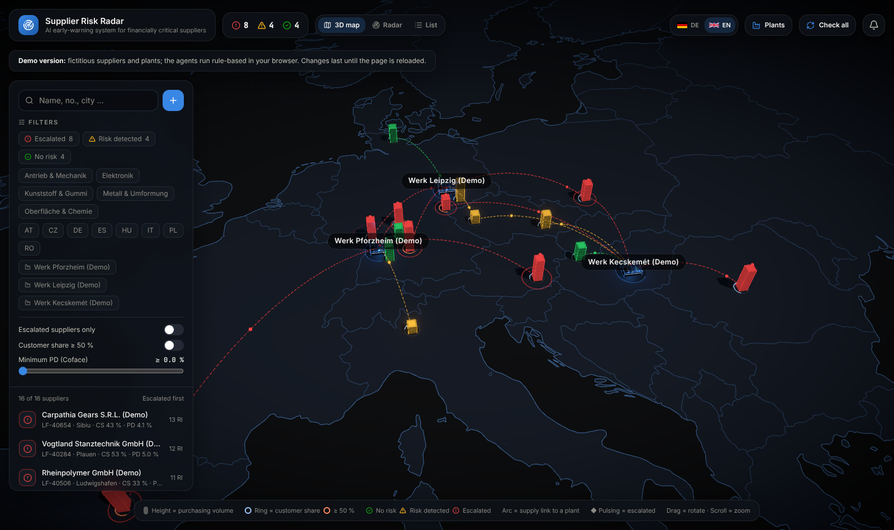
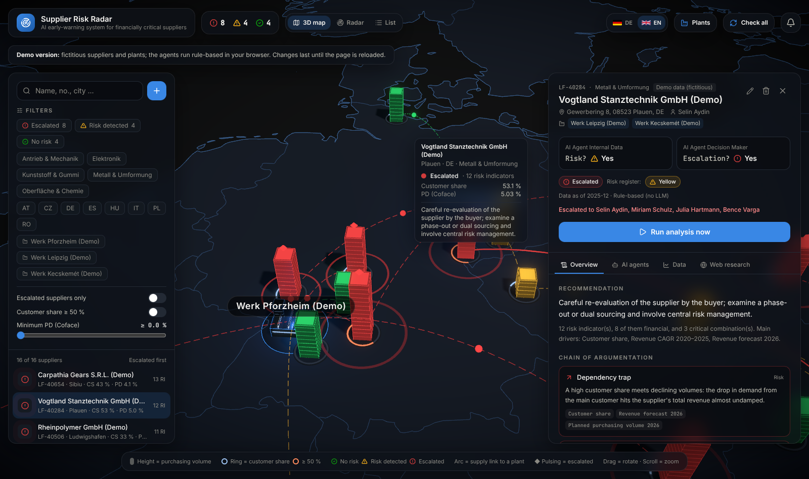
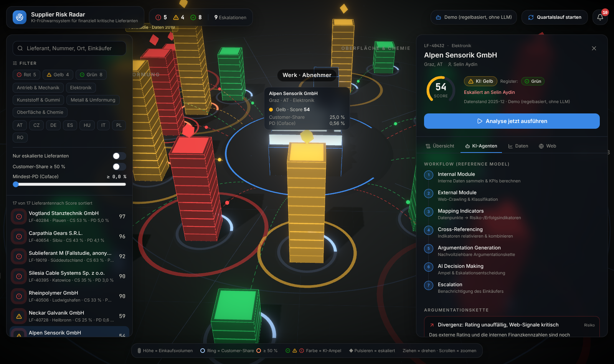
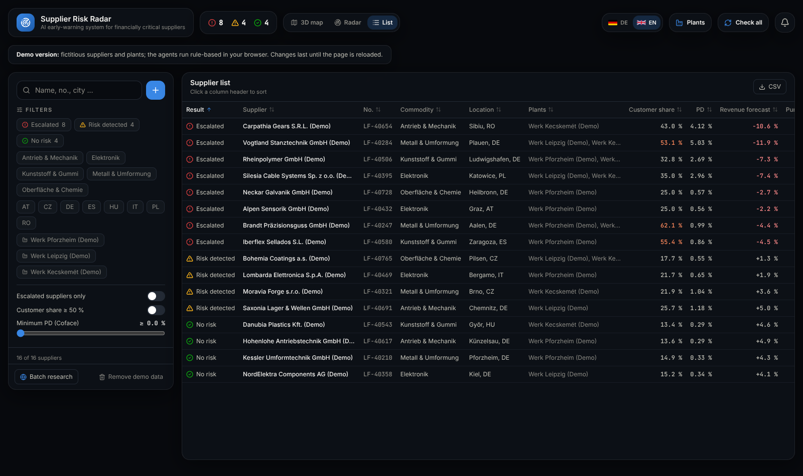
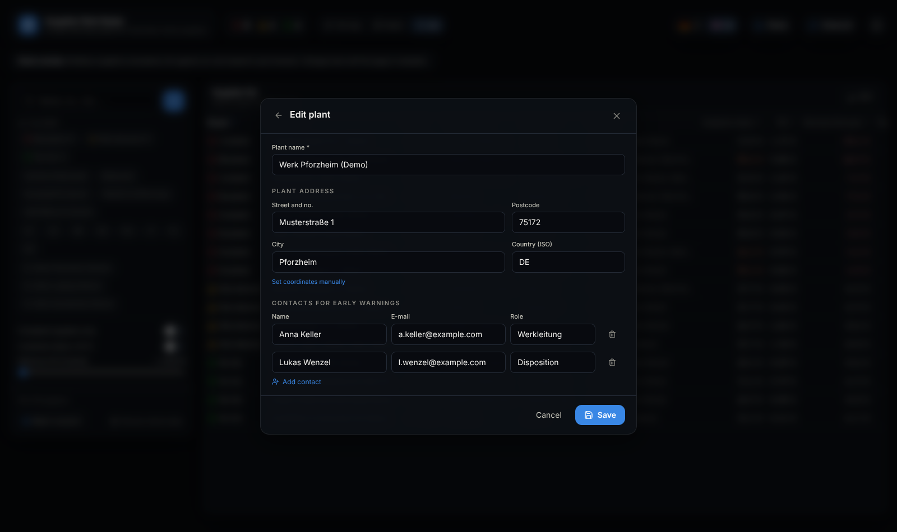
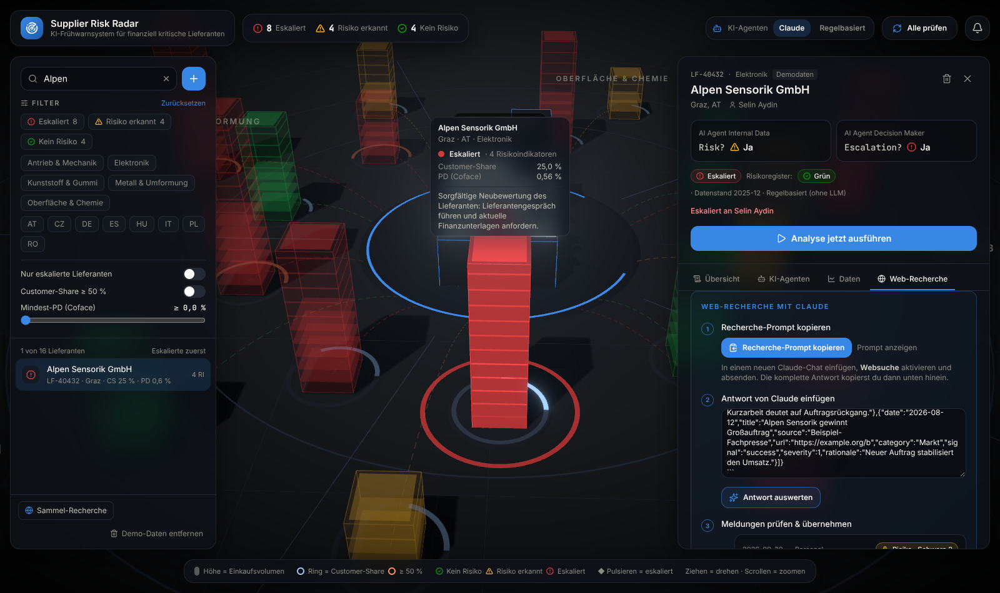

# Supplier Risk Radar

An agent system evaluates every supplier on record. It combines internal indicators (customer share, revenue development, planned purchasing volumes, Coface probability of default, quality) with information from the web. Following the underlying reference model, the *Internal Data* agent first decides **"Risk?"**. If a risk is present, the Decision Module builds a **traceable chain of argumentation** and decides **"Escalation?"**, together with an action-oriented recommendation. There is deliberately no numeric score. When a case is escalated, the responsible buyer and the contacts of every plant the supplier delivers to are warned, in auto mode also via Outlook and Teams.

The cockpit offers three views:

- **3D map:** countries as a dark relief, the organisation's plants as hubs, suppliers as buildings at their address, and an arc from every supplier to each plant it supplies.
- **3D radar:** one plant in the centre, suppliers around it grouped by commodity.
- **List:** a sortable table for quick comparison (CSV export).

Users can search, filter (also by plant), add and edit suppliers with their address, and manage the plants with their contacts. The interface and the texts the agents write switch between **German and English** (flags at the top right).



| Supplier with chain of argumentation and recipients | AI agents: workflow and decisions |
|---|---|
|  |  |

| List view | Plant with contacts for early warnings |
|---|---|
|  |  |

| Editing a supplier (address, plants) | Web research with Claude (online version) |
|---|---|
|  |  |

## Three variants

| | Server version | Online version (claude.ai artifact) | Standalone demo |
|---|---|---|---|
| Start | `docker compose up`, or Python + Node | Open a link, no installation | One HTML file, any web host or double-click |
| AI agents | Claude API, Ollama (offline) or rule-based | Claude via the viewer's own claude.ai account, or rule-based | Rule-based |
| Data | SQLite | Shared artifact database | Fictitious demo data in memory |
| Web signals | Live crawling | Research prompt → Claude chat with web search → paste the answer back | Same prompt workflow |
| SAP/ERP, Outlook, Teams, auto mode | ✅ | – | – |

Builds: `cd frontend && npm run build:artifact` (online version) and `npm run build:demo` (standalone demo → `frontend/dist-demo/index.html`). The demo can be published by dragging that file onto [Netlify Drop](https://app.netlify.com/drop); the repository itself can stay private. All differences, and where they live in the code, are listed in [`docs/ARTIFACT_VARIANT.md`](docs/ARTIFACT_VARIANT.md).

## From paper to software

| Paper (Figures 2–4) | Implementation |
|---|---|
| **Internal Module**: master data, spend cube, demand planning, quality management, risk management | `backend/app/modules/internal_module.py`: computes up to 11 KPIs, each with its formula, threshold and source. Missing data sources are reported instead of guessed. |
| **External Module**: web crawler + AI agent *External Data* | `backend/app/modules/external_module.py`: crawls the supplier's website (respecting robots.txt) and searches the news; classifies each document by category, signal and severity |
| **Decision Module**: Mapping Indicators → Cross-Referencing → Argumentation Generation → AI Decision Making → Escalation? | `backend/app/modules/decision_module.py` + `backend/app/pipeline.py`: a fixed task list in exactly this order, which can be followed live in the cockpit |
| Internal / External / Result Data Storage | SQLite (`backend/app/db.py`) |
| Data integration from internal systems via APIs | `backend/app/connectors/`: SAP S/4HANA, generic ERP via REST, manual entry |
| Notification of the buyer | `backend/app/notifiers/`: cockpit, Outlook (Microsoft Graph), Microsoft Teams |
| Regular, automated evaluation (e.g. quarterly) | `backend/app/automode.py` |
| Offline LLM for internal data | `LLM_PROVIDER=ollama` |

**Process as in the paper (Figures 2 and 4), without a score:**

1. **Internal Module:** KPIs with formula, threshold and source.
2. **Risk?** (AI agent *Internal Data*): if no, the result is "risk evaluation next quarter" and the run ends. If yes, the run continues.
3. **External Module:** web signals.
4. **Decision Module:** Mapping Indicators (risk or success indicator, strong or weak) → Cross-Referencing (relativising and weighing indicators, prioritising financial over quality signals, detecting critical combinations) → Argumentation Generation → AI Decision Making: **Escalation?** plus a recommendation.
5. **Escalation:** yes goes to the buyer, no goes to the Result Data Storage.

KPIs and forecasts are computed deterministically in code so that every figure stays traceable. The LLM agents make the decisions and formulate the arguments. Without an LLM (`LLM_PROVIDER=demo`), transparent rules decide: a case is escalated when there is a critical combination or a financial indicator clearly above its threshold. Quality indicators alone never lead to an escalation.

## Plants, suppliers and who gets warned

- **Plants** (button *Plants* at the top): name, address and any number of contacts (name, e-mail, role).
- **Suppliers:** the **＋** button next to the search field adds one; the pencil in the detail view edits it.
  - Only the supplier number and name are required.
  - The address places the supplier on the map; city and country are enough. Coordinates can also be set by hand.
  - *Supplies our plants* links the supplier to one or more plants.
- **Recipients of an escalation:** the responsible buyer plus every contact of all linked plants; an address that appears twice is warned once. Outlook sends one e-mail per person; Teams and the cockpit get one message naming everyone. The detail view lists the recipients in advance.
  - Key figures are optional: spend cube for the last three years, planned volume, current Coface PD and the value 12 months ago, complaint rate and on-time delivery.
  - The agents evaluate the supplier immediately after saving. If data sources are missing, the assessment says so.
- **Search:** the search field filters by name, supplier number, address, commodity and buyer. Further filters: result (escalated / risk detected / no risk), commodity, country, plant, escalations only, customer share ≥ 50 % and minimum PD.
- **Via the API:** `POST /api/suppliers` (master data, address, `plant_ids`, optional `figures`), `POST /api/plants`, or `POST /api/suppliers/import` (from a source system, see below).

### Geocoding

Addresses are located offline from a bundled list of cities (`data/gazetteer.json`, built from [GeoNames](https://www.geonames.org/), CC BY 4.0); if the city is unknown, the country is used. With `GEOCODER=nominatim` the server version locates street addresses via OpenStreetMap Nominatim (please respect its usage policy). Country shapes on the map: [Natural Earth](https://www.naturalearthdata.com/) via `world-atlas`.

### Language

The flags at the top right switch the interface and all generated texts (KPIs, arguments, recommendations, e-mails) between German and English. API calls take `?lang=de|en`; auto mode has its own language setting; `DEFAULT_LANG` sets the default.

## Interfaces (backend)

The interfaces to SAP, other systems, Outlook and Teams are fully prepared in the backend and are activated through environment variables. Without configuration they report "not configured" and the rest of the application keeps running.

⚠️ So far they have only been tested against simulated responses, not against live SAP or Microsoft 365 systems.

### Source systems: searching supplier numbers

Every system implements `SourceConnector` (`backend/app/connectors/base.py`):

| Method | Purpose |
|---|---|
| `search(query)` | Find suppliers by number or name |
| `get_master(number)` | Master data for a supplier number |
| `get_internal_data(number)` | Key figures for the Internal Module (format below) |

| Connector | ID | Configuration | Status |
|---|---|---|---|
| Cockpit (manual entry) | `local` | – | active |
| SAP S/4HANA | `sap` | `SAP_BASE_URL`, `SAP_CLIENT`, `SAP_USER`, `SAP_PASSWORD` | Search and master data via OData `API_BUSINESS_PARTNER/A_Supplier`. Key figures are company-specific (purchasing info records, purchase order history, IBP/BW, QM notifications); their mapping is added in `get_internal_data`. |
| Any system via REST | `erp` | `ERP_NAME`, `ERP_BASE_URL`, `ERP_TOKEN` | expects `GET /suppliers?q=`, `GET /suppliers/{no}`, `GET /suppliers/{no}/risk-data` |

Connecting a new system means deriving a class from `SourceConnector` and registering it in `connectors/__init__.py`.

API:

```http
GET  /api/sources                                    # registered systems and their status
GET  /api/sources/search?q=7001&source=sap&source=erp # search, filterable by source system
POST /api/suppliers/import  {"source": "sap", "number": "100200", "buyer_email": "…"}
```

### Notifications: Outlook & Teams

| Channel | ID | Configuration |
|---|---|---|
| Cockpit (bell icon) | `inapp` | – |
| Outlook via Microsoft Graph `sendMail` | `outlook` | App registration in Entra ID with the application permission `Mail.Send` (admin consent; restrict it to the sender mailbox with an application access policy) → `MS_TENANT_ID`, `MS_CLIENT_ID`, `MS_CLIENT_SECRET`, `OUTLOOK_SENDER` |
| Microsoft Teams (Adaptive Card) | `teams` | In the channel: *Workflows → "Post to a channel when a webhook request is received"* → URL as `TEAMS_WEBHOOK_URL` |

E-mails go to the buyer and to the contacts of all linked plants, one e-mail per person. Both the e-mail and the Teams card contain the summary, the recommendation, the measures and a direct link (`APP_BASE_URL/?supplier=…`). Every delivery attempt is logged with its status (`GET /api/notifications`).

### Auto mode

At a configurable interval, auto mode checks **every supplier number on record**. For each supplier it:

1. refreshes master data and key figures from the respective source system,
2. runs the complete agent pipeline,
3. sends an e-mail and/or Teams message to the responsible buyer and the contacts of the linked plants whenever a case is escalated.

It can be switched on in the cockpit ("Automode" toggle), through the API (`PUT /api/automode {"enabled": true, "interval_minutes": 1440, "channels": ["outlook","teams"]}`, or start a run immediately with `POST /api/automode/run`), or with `AUTOMODE_ENABLED=true` as the initial value.

## Quick start

### With Docker

```bash
cp .env.example .env          # add LLM, SAP, Microsoft 365 … settings as needed
docker compose up --build
# → http://localhost:8000
```

### Development

```bash
# Backend
cd backend
python -m venv .venv && source .venv/bin/activate
pip install -r requirements.txt
uvicorn app.main:app --reload --port 8000

# Frontend (second terminal)
cd frontend
npm install
npm run dev
# → http://localhost:5173
```

Tests: `cd backend && pytest`

All settings are documented in [`.env.example`](.env.example). With `SEED_DEMO_DATA=false` the system starts without the fictitious demo suppliers and plants (all marked "(Demo)").

Texts generated by the agents live in `backend/app/i18n.py`. After changing them, run `python scripts/gen-texts.py` so the browser engine uses the same texts; after changing `backend/app/seed.py`, run `python scripts/export-demo-seed.py`.

## Internal Module data format

This is how source systems deliver key figures (`get_internal_data` or `GET /suppliers/{no}/risk-data`). Every block is optional:

```jsonc
{
  "as_of": "2025-12",
  "revenue":  { "2023": 40.1, "2024": 41.0, "2025": 39.2 },  // supplier revenue, EUR m
  "purchase": { "2023": 12.3, "2024": 13.0, "2025": 14.1 },  // our purchasing volume (spend cube)
  "plan_snapshots": [                                          // plan versions from demand planning
    { "date": "2025-Q3", "volumes": { "2026": 13.5, "2027": 13.9 } }
  ],
  "pd_history": [ { "date": "2025-05-01", "pd": 0.8 } ],      // Coface rating history
  "quality": { "2025": { "ppm": 45, "otd": 0.97 } }           // complaints, on-time delivery
}
```

All thresholds are defined in `THRESHOLDS` (`internal_module.py`). Apart from the 50 % customer-share limit and the yellow area of the Coface PD (~2 %) taken from the paper, they are assumptions that should be aligned with the organisation's internal limits. The prioritisation (financial before external before operational) and the escalation rule are in `decision_module.py`.

## API overview

| Method | Path | Purpose |
|---|---|---|
| GET | `/api/suppliers?q=` | Suppliers with their latest assessment, search by name or number |
| POST | `/api/suppliers` | Add a supplier (and evaluate it immediately) |
| PUT / DELETE | `/api/suppliers/{id}` | Update (and re-evaluate) / delete a supplier |
| GET / POST | `/api/plants` | Plants with contacts and linked suppliers / add a plant |
| PUT / DELETE | `/api/plants/{id}` | Update / delete a plant |
| GET | `/api/suppliers/{id}` | Report and history |
| POST | `/api/suppliers/{id}/analyze` | Run the pipeline (server-sent events) |
| POST | `/api/cycle` | Evaluate all suppliers (server-sent events) |
| GET | `/api/sources`, `/api/sources/search` | Source systems and search |
| POST | `/api/suppliers/import` | Import a supplier from a source system |
| GET | `/api/channels`, `/api/notifications` | Channels and delivery log |
| GET / PUT | `/api/automode` | Auto mode status and settings |
| POST | `/api/automode/run` | Start an auto mode run immediately |

## Limitations

- The accuracy shown in the paper comes from a single case. It demonstrates feasibility, not a generally valid detection rate.
- The connections to SAP, other systems and Microsoft 365 still need to be tested in the respective corporate environment.
- For SAP, the company-specific mapping of transactional data is still to be added.

## License

Copyright (c) 2026 Clemens Claussen. **All rights reserved.** The code is published for viewing only; using, copying, modifying or distributing it requires prior written permission. See [`LICENSE`](LICENSE).
